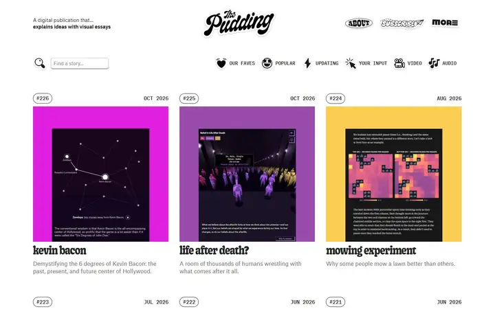
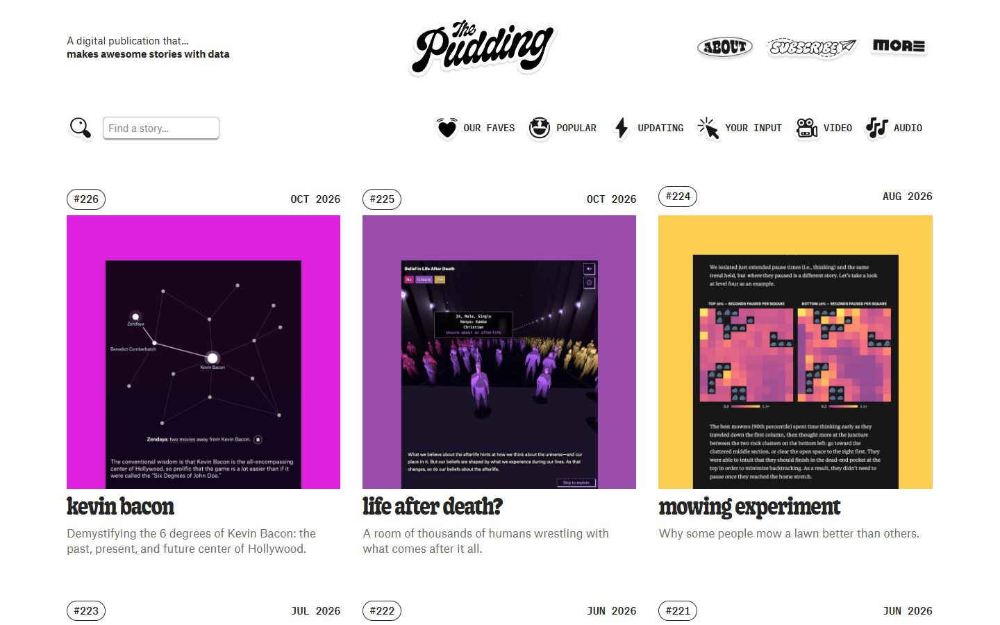
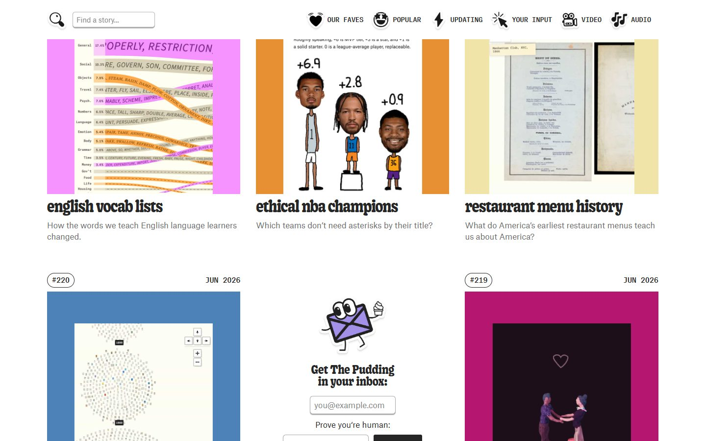
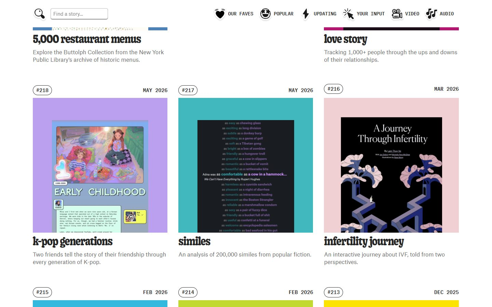
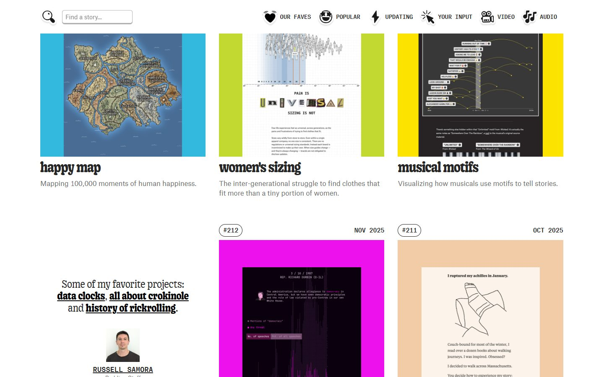
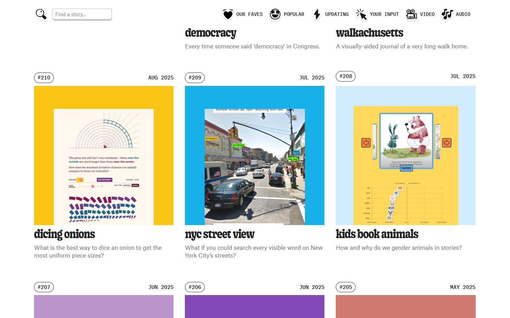
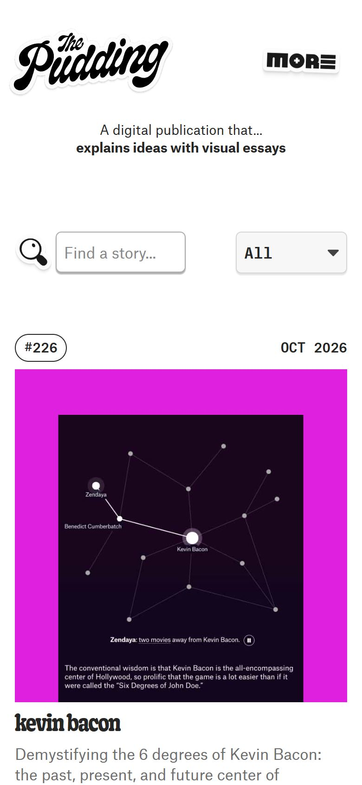

# The Pudding

<!-- gallery:start -->

<a href="../../README.md#type-foundries-and-editorial">All sites</a> &nbsp;&nbsp; <a href="../stripe-press/teardown.md">&larr; Stripe Press</a> &nbsp;&nbsp; <a href="../gwern/teardown.md">Gwern.net &rarr;</a> &nbsp;&nbsp; <a href="https://pudding.cool">Open the live site</a>

<!-- gallery:end -->

Looked at on 2026-10-28. https://pudding.cool

**The idea:** a numbered back catalogue where every thumbnail is a real frame from the story.

## What you see

A white page with a three-column grid. Every card has the issue number in an outlined pill and the month in Atlas Typewriter, a square thumbnail, the title in heavy lowercase Gooper SemiCondensed, and a one-line dek in grey Atlas Grotesk. Each thumbnail is a screenshot from inside the story, inset on a flat colour field. The newsletter signup and one staff member's picks, with their photo, take ordinary grid slots. The tagline under the logo changes: "makes awesome stories with data" on desktop, "explains ideas with visual essays" on the phone.

## Stack

| Layer | What |
|---|---|
| Framework | SvelteKit (`_app/immutable` chunks) |
| Hosting | Amazon S3 behind CloudFront |
| Fonts | Atlas Grotesk, Atlas Typewriter, Gooper SemiCondensed |
| Weight | 3,769 KB over 79 requests: 3,204 KB images, 420 KB fonts, 67 KB JS |
| Reduced motion | Yes, the CSS has a `prefers-reduced-motion` rule |

## Steal

- Thumbnails cut from the real work, framed on one flat colour per story. The grid shows the work and still reads as one page.
- Three faces, three jobs: heavy condensed serif for titles, grotesk for decks, typewriter for data.
- Issue numbers make the archive countable, like a magazine run.
- Non-story tiles (newsletter, a person's picks) sit in the same grid slots instead of banners.

## Don't steal

- The mono caps month and pill-framed number above every card. It is real data here, but it is the banned kicker shape; keep the data, drop the caps and the pill.
- The sticker logo and drop-shadowed icons are their brand. Copied elsewhere they are decoration.
