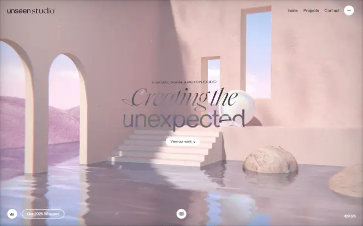
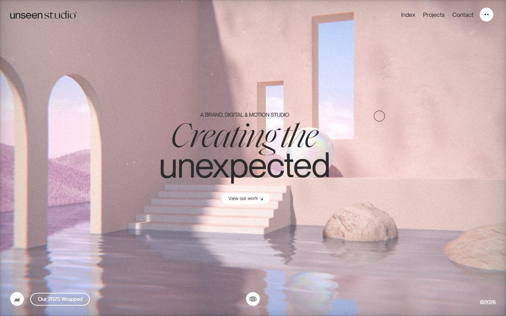
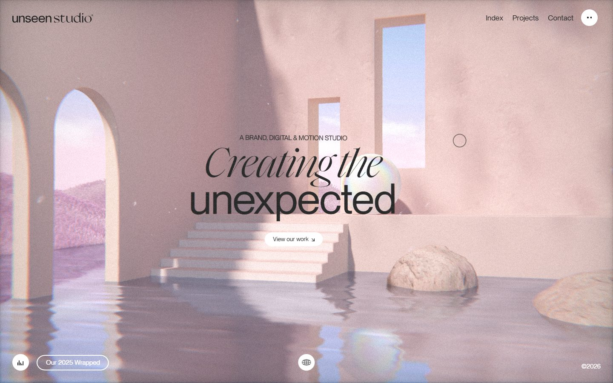
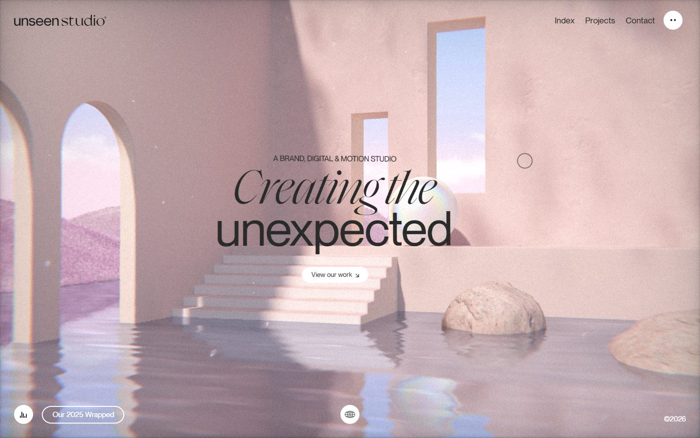
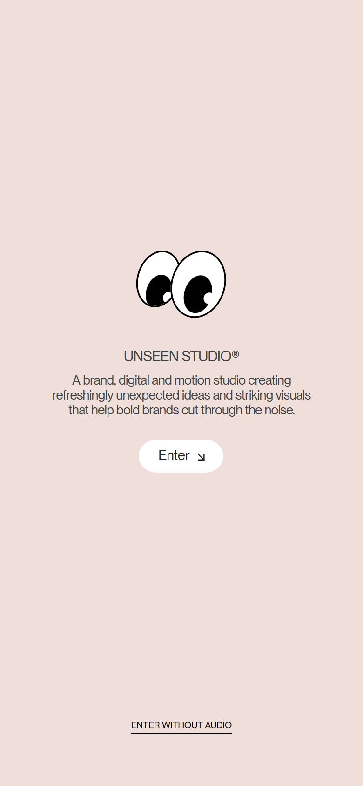

# Unseen Studio

<!-- gallery:start -->

<a href="../../README.md#worlds">All sites</a> &nbsp;&nbsp; <a href="../dogstudio/teardown.md">&larr; Dogstudio</a> &nbsp;&nbsp; <a href="../immersive-garden/teardown.md">Immersive Garden &rarr;</a> &nbsp;&nbsp; <a href="https://unseen.co">Open the live site</a>

<!-- gallery:end -->

Looked at on 2026-10-28. https://unseen.co

**The idea:** the homepage is a pastel world you drag through, not a page you scroll.

## What you see
A soft pink room: two arches, tall windows of sky, steps going down into water, two rocks and an iridescent sphere, with film grain and a slight colour fringe at the edges. The headline pairs an italic serif ("Creating the") with a grotesk ("unexpected"). All five desktop captures show this one frame; only the water moves. The HTML says "Drag to explore our world" and "Click & Hold", so the room is navigated by dragging, not scrolling. The phone stops at an enter gate with two cartoon eyes and a choice to enter with or without audio.

## Stack
| Layer | What |
|---|---|
| CMS | WordPress, custom theme (`wp-content/themes/unseen`) |
| 3D | three.js r143 |
| Fonts | Saol Display, Neue Montreal |
| Weight | 7.2 MB (2 MB images, 948 KB video, 413 KB JS), 125 requests |
| Reduced motion | No |
| Hosting | nginx-rc |

## Steal
- One still set as the whole home page. No sections to scroll past.
- "Enter without audio" as a full, equal button on the gate.
- Grain over the render, so the 3D reads like a photo of a built set.
- Two typefaces in one headline, split by phrase rather than by word.

## Don't steal
- The small uppercase line above the headline, "A BRAND, DIGITAL & MOTION STUDIO". That is the kicker pattern.
- Floating corner chips: the "Our 2025 Wrapped" pill, a sound button, a globe button, "©2026".
- The iridescent sphere and rainbow fringe. Stock 3D-render props with no tie to the studio.
- Copy like "refreshingly unexpected ideas and striking visuals that help bold brands cut through the noise".
